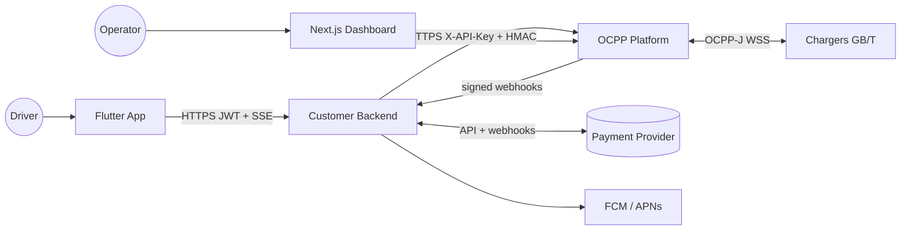
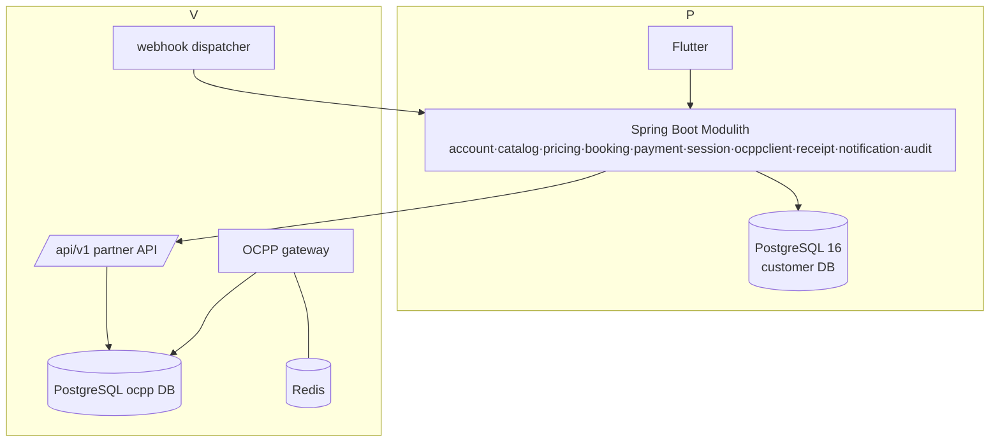

# Architecture

Tags: **[V]** verified existing · **[P]** proposed · **[A]** assumption · **[U]** unresolved (see `PROJECT_OVERVIEW.md`).

## 1. Existing OCPP platform (verified)

Source: `backend/` of this repository, `docs/12`–`17`, `docs/partner-api.md`, migrations V1–V41.

* **[V]** Spring Boot 4.1 / Java 21 **Modulith** monolith, PostgreSQL 16 + Flyway,
  Redis, raw `TextWebSocketHandler` OCPP 1.6-J gateway. Modules: `ocpp`, `charging`,
  `assets`, `identity`, `auth`, `tariff`, `publicapi`, `webhook`, `shared`
  (`billing` and `notification` are empty `package-info` only).
* **[V]** Three auth mechanisms: chargers = HTTP Basic at WS handshake; dashboard =
  JWT; **partners = static `X-API-Key`** (SHA-256 hashed), optional IP allowlist
  (`X-Real-IP` only), optional HMAC request signing, scopes `READ`,
  `CHARGING_COMMANDS`, `ID_TAGS_WRITE`, optional key expiry.
* **[V]** Outbound OCPP commands implemented: `RemoteStartTransaction`
  (connectorId + idTag only), `RemoteStopTransaction`, `UnlockConnector`, `Reset`,
  `TriggerMessage`, `ChangeConfiguration`, `DataTransfer`.
  **Not implemented** (schemas vendored, no code): `ReserveNow`, `CancelReservation`,
  `SetChargingProfile`, `ClearChargingProfile`.
* **[V]** Tariff = one active **per-kWh** price per country, frozen on the
  transaction at `StartTransaction` (`LOCKED` / `MISSING_AT_START` / legacy).
* **[V]** `billing` and `notification` modules do not exist; payments are out of
  scope of the platform. `costMinor` is "a calculated figure, not a record of payment".
* **[V]** Known debt: OCPP command routing between JVM nodes has no consumer
  (S6/S27) → **single instance only**. Rate limiter is in-memory.

## 2. New customer backend [P]

Separate repository directory `users/backend`, Spring Boot 4.1 / Java 21 Modulith
(same stack as the sibling so conventions, CI and operators carry over), PostgreSQL 16
own database, Flyway. **No shared database, no shared code module, no access to the
OCPP database.** Package root `com.evcharge.customer.*`.

| Module | Responsibility | Owns data |
|---|---|---|
| `account` | Registration, login, JWT, refresh, device tokens, `ocppIdTag` per customer | customer, credential, refresh_token |
| `catalog` | Read-through view of stations/connectors from OCPP (TTL cache); QR resolve | none (cache only) |
| `pricing` | Estimate & limit math (long minor units) | tariff_quote |
| `booking` | Connector hold (reservation) with DB-enforced exclusivity | reservation |
| `payment` | `PaymentProvider` port + adapter, authorization/capture/refund, webhook verify | payment_authorization, payment_transaction, refund |
| `session` | Orchestrator: owns charging-session state, limit watcher, recovery | charging_session, session_command, meter_reading |
| `ocppclient` | The **only** module that talks to OCPP platform: REST client, webhook receiver, sync poller | webhook_inbox, sync_cursor |
| `receipt` | Receipt generation | receipt |
| `notification` | Push/email | notification_outbox |
| `audit` | Append-only audit log | audit_record |
| `shared` | ids, `Money`, errors, clock | – |

`ModuleStructureTest` (Spring Modulith verify) from day one, as in the sibling. **[P]**
Cross-module calls go through public module API or Spring application events;
`ocppclient` exposes a domain-language port (`ChargerGateway`) so no OCPP-platform DTO
leaks into other modules.

### Why a modular monolith and not microservices
Same reasoning as the OCPP repo's ADR: a small team, one deployable, one DB
transaction boundary for the booking→payment→session invariants. Splitting would turn
the critical invariants into distributed transactions.

### Why not extend the OCPP platform instead
The brief requires a separate app. It is also right on the merits: the platform has
no customer identity, no payment concepts, and its partner contract deliberately
"authenticates the client, not each end user" [V]. Customer concerns would otherwise
break its isolation model.

## 3. Flutter application [P]

Feature-first, Riverpod (`riverpod` 3 + `riverpod_annotation`/generator), `go_router`,
`dio`, `freezed` + `json_serializable`. Layers per feature: `presentation` (widgets +
`Notifier`s) → `domain` (entities, use-cases, repository interfaces) → `data`
(DTOs, Dio clients, mappers). Rules: no business logic in widgets; server is the
authority on session/payment state — the app renders `SessionView` snapshots and
never infers "charging started" from a local tap. Secure storage for refresh token.
Current state **[V]**: `users/mobile` is the untouched `flutter create` counter
template (only `lib/main.dart`), SDK `^3.12.2`; nothing to preserve.

## 4. Diagrams

### System context

### Containers

## 5. Communication CB ↔ OCPP

| Direction | Mechanism | Use |
|---|---|---|
| CB → OCPP | REST `/api/v1/**`, `X-API-Key`, HMAC request signing (`docs/16`), `Idempotency-Key` on start/stop, source-IP allowlist | catalog, start, stop, command status |
| OCPP → CB | Signed webhooks (HMAC V2, at-least-once, 6 attempts then `FAILED`) | `session.started/metering/stopped`, `command.result`, `connector.status`, `device.online/offline` |
| CB → OCPP (reconciliation) | `GET /api/v1/sessions/sync` (cursor), `GET /api/v1/events`, `GET /api/v1/commands/{id}`, `GET /api/v1/sessions/{id}` | repair missed webhooks, restart recovery |

Webhooks are the nominal path; polling is only recovery. **[V]** OCPP docs say the
same. Webhook destination registration is ADMIN-only, https-only [V].

## 6. Authentication & authorization boundaries

* App ↔ CB: short-lived JWT (15 min) + rotating refresh token (stored hashed); every
  query scoped by `customerId` from the token, never from request input. **[P]**
* CB ↔ OCPP: one `external_client` named e.g. `customer-backend`, mode `PARTNER`,
  scopes `READ`+`CHARGING_COMMANDS`+`ID_TAGS_WRITE`, key expiry set, IP allowlist,
  `require_request_signature=true`. **[P]** on **[V]** capabilities.
* The OCPP platform sees **one** client for all customers; per-customer authorization
  is entirely ours. The customer's identity reaches OCPP only as a stable `idTag`.
* Station ownership: a charger is startable by the client only if an ADMIN assigned
  it via `PUT /api/operator/charge-points/{id}/owner` (V34) **[V]** — an operational
  prerequisite per station.

## 7. Data ownership & synchronization

| Data | Authority | CB keeps |
|---|---|---|
| Station, connector, status, location | OCPP | cache with TTL (≤30 s status, ≤1 h metadata); reference `(deviceId, connectorId)` only |
| Transaction id, meter start/stop, energy, stop reason | OCPP | copy on the session at start/stop (needed for receipts and as audit evidence) |
| Per-kWh price used | OCPP freezes `pricePerKwhMinor` at start | copy (`session.pricePerKwhMinor`) **plus** the quote shown to the customer |
| Final `costMinor` | OCPP computes | **[P]** CB takes it as the *billable* amount, reconciles against its own quote |
| Customer, holds, payments, receipts | CB | – |

## 8. Technology decisions

| Decision | Choice | Justification |
|---|---|---|
| DB | PostgreSQL 16 | Partial unique indexes + `SELECT … FOR UPDATE SKIP LOCKED` + exclusion constraints give the connector-exclusivity and outbox patterns without extra infra; same as OCPP side |
| Cache/locks | **No Redis in v1** | Not needed: exclusivity lives in DB constraints; single instance; add Redis only when SSE fan-out needs multiple nodes **[P]** |
| Live updates to app | **SSE** (`/v1/sessions/{id}/events`) + REST snapshot on (re)connect + FCM for background | One-way server push fits; works through Caddy; trivial reconnect with `Last-Event-ID`; WebSocket adds nothing since the app sends no stream upward. Polling remains the fallback |
| Message broker | None | Spring events + transactional outbox table; Kafka is excluded by the sibling's ADR too |
| Money | `long` minor units + `currency` + `decimals` (`Money` value object) | Matches OCPP rule n°7 and V25 normalization |
| Payment | `PaymentProvider` port, one adapter | Provider **[U]**; capabilities **[A]** |
| API style | REST + OpenAPI generated from code, `/v1` prefix, RFC 7807 errors | Matches sibling |

## 9. Deployment & operations [P]

Own container + own Postgres on the same VPS initially (Caddy in front, as the
sibling), separate compose file and secrets. **Single instance** (consistent with the
OCPP side's constraint; scheduled jobs use `SKIP LOCKED` so a second instance later is
safe). Health `/actuator/health`, metrics, alerting on: webhook inbox lag, sessions in
`STOPPING` > N s, payments in `CAPTURE_FAILED`, reconciliation mismatches. Backups
and PITR for the customer DB are a launch gate (it holds money state).
