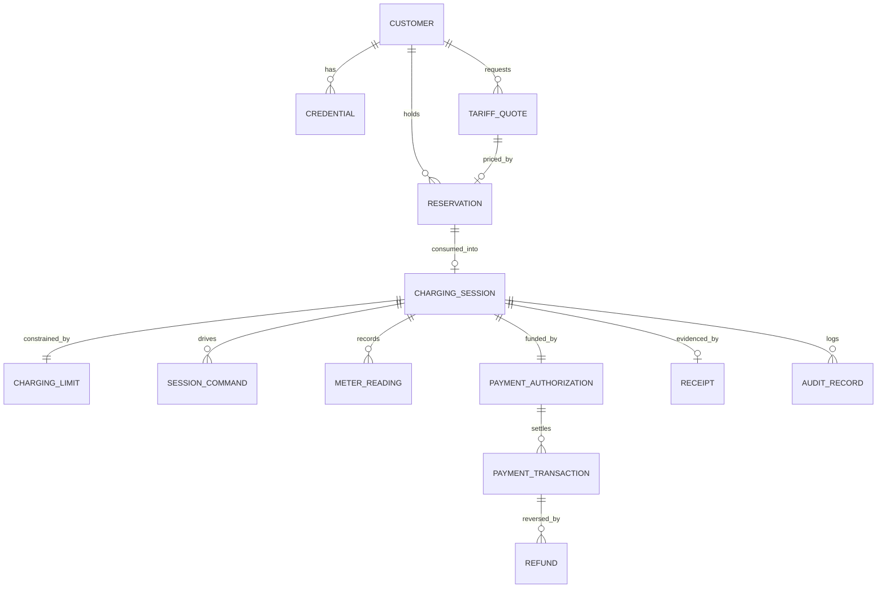

# Data Model (customer backend)

All **[P]**. PostgreSQL 16, Flyway `V{n}__*.sql`, never edited after commit (sibling
convention [V]). PKs are UUID v7 generated by the app, except where noted. All
timestamps `timestamptz` UTC. **Money = `bigint` minor units + `currency char(3)` +
`currency_decimals smallint`** — never `numeric`/float (sibling rule n°7 [V]).
Energy = `numeric(12,3)` kWh (the platform returns 3 dp [V]).

## 1. Ownership principle

CB stores **references** `(device_id, connector_id)` to OCPP-owned stations — no
station table. Anything copied from OCPP is copied *because it is evidence for a
financial record* (price, meter, cost) and is stamped with its source and capture time.
Station metadata is cached in memory/`station_cache` with TTL only.

## 2. Entities



| Entity | Key columns | Notes |
|---|---|---|
| `customer` | id, email/phone (unique, normalized), status, `ocpp_id_tag` UNIQUE (`Z-…`≤20), country_iso, locale, `debt_flag`, created_at | `ocpp_id_tag` never reused or reassigned. PII minimal |
| `credential` / `refresh_token` | customer_id, hash (argon2id / SHA-256 of token), device, expires_at, rotated_from | refresh tokens stored hashed, rotation + reuse detection |
| `tariff_quote` | id, customer_id, device_id, connector_id, price_per_kwh_minor, currency, decimals, limit_type, limit_value, cap_kwh, estimate_minor, source_fetched_at, expires_at | immutable. Evidence of what the customer agreed to |
| `reservation` | id, customer_id, quote_id, device_id, connector_id, state, expires_at, idempotency_key, version | see constraints §3 |
| `charging_limit` | session_id PK, type `ENERGY_KWH\|MAX_AMOUNT\|FULL`, target_kwh, max_amount_minor, cap_kwh_effective, safety_window_s | 1:1 with session, immutable after CHARGING |
| `charging_session` | id, customer_id, reservation_id, quote_id, device_id, connector_id, state, `ocpp_transaction_id` (int, **NOT NULL CHECK >0 once set; 0 is rejected** [V sentinel]), started_at, stopped_at, meter_start_wh?, energy_kwh, cost_minor, currency, decimals, price_per_kwh_minor (frozen by platform), stop_reason, soc_start, soc_end, late_start, monitoring_degraded, version | `started_at/stopped_at` are **platform timestamps**, never `now()` (sibling rule n°2 [V]) |
| `session_command` | id, session_id, kind, attempt, idempotency_key UNIQUE, state, ocpp_command_id, request_at, response_code, reason_code, failure_reason | one row per attempt |
| `meter_reading` | session_id, sampled_at, total_kwh, power_kw?, voltage?, current_a?, soc?, source_event_id UNIQUE, received_at | `null` = never reported, not 0 [V]. Append-only |
| `payment_authorization` | id, session_id UNIQUE, provider, provider_ref UNIQUE, amount_minor, currency, decimals, state, idempotency_key, expires_at | |
| `payment_transaction` | id, authorization_id, type `CAPTURE`, amount_minor, state, provider_ref UNIQUE, idempotency_key UNIQUE, failure_code, attempts, next_retry_at | one CAPTURE per session (UNIQUE session via auth) |
| `refund` | id, payment_transaction_id, amount_minor, state, reason, idempotency_key UNIQUE, provider_ref | |
| `receipt` | id, session_id UNIQUE, number (gapless-per-country sequence **[U]**), payload jsonb (frozen), pdf_ref, issued_at | immutable once issued; corrections are credit notes |
| `webhook_inbox` | event_id UNIQUE, source (`ocpp`\|`psp`), received_at, payload, processed_at, attempts | dedupe + replay |
| `sync_cursor` | name PK, cursor, updated_at | OCPP `/sessions/sync` position |
| `idempotency_key` | customer_id, key, request_fingerprint, response, expires_at; UNIQUE(customer_id,key) | API-level, 24 h |
| `outbox` | id, topic, payload, available_at, claimed_by, state | transactional outbox (commands, notifications) |
| `audit_record` | id, at, actor, subject_type, subject_id, from_state, to_state, trigger, correlation_id, detail | append-only (REVOKE UPDATE/DELETE) |

## 3. Constraints that carry the safety invariants

```sql
-- No two live holds on one connector; one live hold per customer.
CREATE UNIQUE INDEX uk_hold_connector ON reservation (device_id, connector_id) WHERE state = 'HELD';
CREATE UNIQUE INDEX uk_hold_customer  ON reservation (customer_id)            WHERE state = 'HELD';

-- No two live sessions on one connector; one live session per customer.
-- live = REQUESTED, START_ACCEPTED, CHARGING, STOPPING
CREATE UNIQUE INDEX uk_session_connector ON charging_session (device_id, connector_id)
  WHERE state IN ('REQUESTED','START_ACCEPTED','CHARGING','STOPPING');
CREATE UNIQUE INDEX uk_session_customer  ON charging_session (customer_id)
  WHERE state IN ('REQUESTED','START_ACCEPTED','CHARGING','STOPPING');

-- Platform transaction mapped at most once.
CREATE UNIQUE INDEX uk_session_txn ON charging_session (ocpp_transaction_id) WHERE ocpp_transaction_id IS NOT NULL;
ALTER TABLE charging_session ADD CHECK (ocpp_transaction_id IS NULL OR ocpp_transaction_id > 0);

-- Money
ALTER TABLE payment_transaction ADD CHECK (amount_minor >= 0);
-- Over-capture / over-refund guarded in a locked update + trigger:
--   sum(capture) <= authorization.amount_minor ; sum(refund) <= capture.amount_minor
```
Never remove an index to make a test pass (sibling rule [V]). Expired holds must be
flipped to `EXPIRED` inside the same transaction that tries to insert a new hold
(lazy expiry), so the unique index never blocks on a stale row.

Hold → session conversion: one transaction updates hold `HELD→CONSUMED` and inserts the
session; `uk_session_*` indexes protect the connector continuously because a `CONSUMED`
hold is replaced by a live session row in the same commit.

## 4. Transaction boundaries

| Operation | Boundary |
|---|---|
| Create hold | 1 tx: lazy-expire, insert hold. Re-check connector at OCPP *after* commit; failure ⇒ compensating tx `FAILED_CONFLICT` |
| Create session | 1 tx: CAS hold→CONSUMED, insert session+limit+authorization ref, outbox(start). Provider call **before** the tx (idempotent, key `auth:{sessionId}` — session id pre-generated); never inside |
| Apply OCPP event | 1 tx: insert `webhook_inbox` (unique ⇒ dup is no-op), CAS state, insert meter/audit, outbox(notification/stop) |
| Settlement | tx A: CAS session→`COMPLETED`, payment→`DUE`; tx B (after provider call): record result. Provider call never inside a DB tx |
| External HTTP | Always via outbox worker (`SKIP LOCKED`) — no remote call while holding row locks |

## 5. Indexes (beyond uniques)

`charging_session(customer_id, started_at DESC)` (history); `charging_session(state)
WHERE state IN (live…)` (recovery); `meter_reading(session_id, sampled_at)`;
`reservation(expires_at) WHERE state='HELD'`; `payment_transaction(next_retry_at)
WHERE state='CAPTURE_FAILED'`; `outbox(available_at) WHERE state='PENDING'`;
`webhook_inbox(processed_at) WHERE processed_at IS NULL`.
`meter_reading`: monthly range partitioning on `sampled_at` **[P]** only if volume
warrants (2 events/30 s per gun [V] ⇒ ≈ 5.7k rows/gun/day: unpartitioned is fine for v1;
decide at 50M rows).

## 6. Retention [U — legal input needed]

| Data | Proposal |
|---|---|
| Financial records (session, payments, refunds, receipts, audit) | ≥ 10 years or local statutory minimum **[U]** |
| `meter_reading` | detail 13 months, then keep only per-session aggregate |
| `webhook_inbox` raw payloads | 90 days after processing |
| `idempotency_key` | 24 h – 7 d |
| Customer PII after deletion request | anonymize customer row; keep financial rows keyed by pseudonymous id |

## 7. Not duplicated on purpose

Station/connector master data, connection state, OCPP transaction ledger, tariff
table, operator data, charger credentials. If the platform's `session` for a
`ocpp_transaction_id` and ours disagree on energy/cost, the **platform's
`session.stopped`/`GET session` wins**, ours is corrected and the delta logged to
`audit_record` and the reconciliation report.

## 8. Wallet additions (decision D3)

| Entity | Key columns | Notes |
|---|---|---|
| `wallet` | customer_id PK, currency `XAF`, decimals 0, `balance_minor`, `reserved_minor`, version | `CHECK (balance_minor >= 0 AND reserved_minor >= 0 AND reserved_minor <= balance_minor)` |
| `ledger_entry` | id, wallet_id, type `TOPUP\|RESERVE\|RELEASE\|CAPTURE\|ADJUSTMENT\|REFUND`, amount_minor, session_id?, topup_id?, idempotency_key UNIQUE, created_at | append-only, double-entry-style, the source of truth; `wallet` row is a locked projection |
| `topup` | id, customer_id, msisdn, operator `AIRTEL\|MOOV`, amount_minor, state, pvit_ref UNIQUE, idempotency_key UNIQUE | PVit top-up attempt |

`payment_authorization` becomes the reservation ledger entry linked to the session;
`payment_transaction` the capture entry. Customer phone/email/name fields and
`auth_provider` (`PASSWORD|GOOGLE|APPLE`), `phone_verified_at`, `status`
(`PENDING_PHONE|ACTIVE|BLOCKED`) are added to `customer`.
