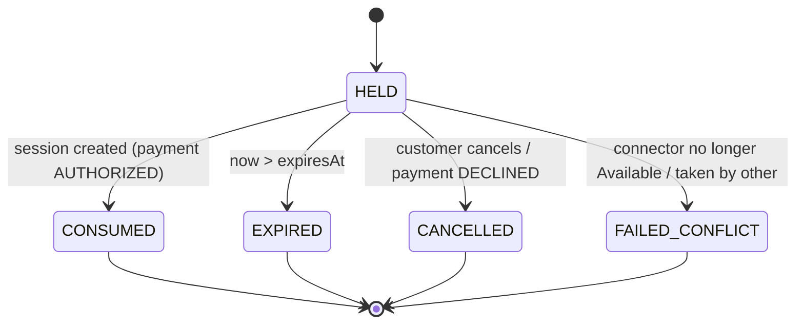
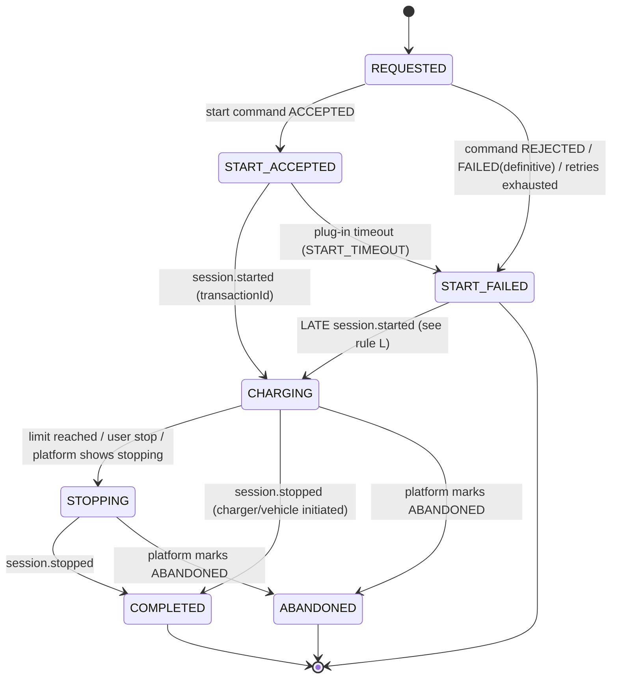
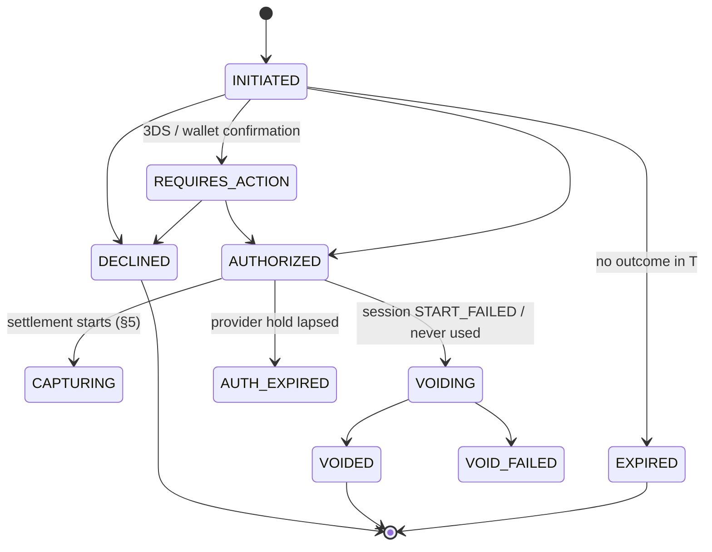
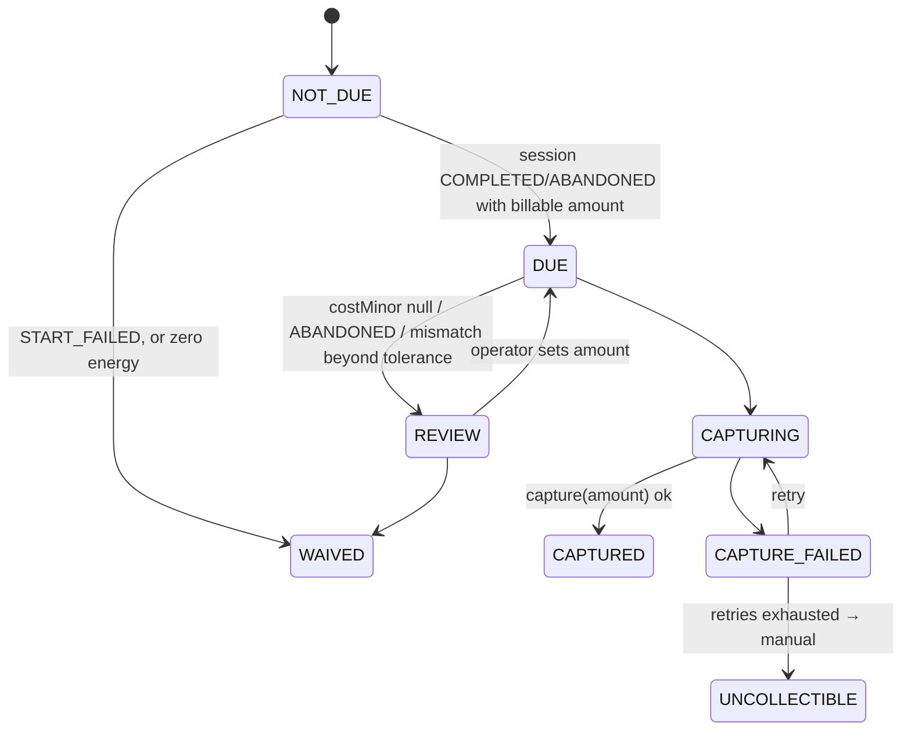
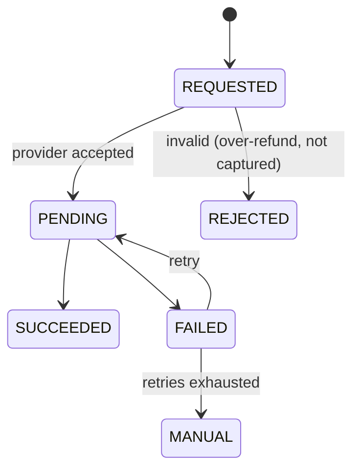

# State Machines

All machines are **[P]**. Platform facts they rely on are **[V]** and cited.
Rules common to all machines:

* **Four independent machines, never merged:** Reservation, Charging session,
  Command, Payment (authorization → capture → refund). A payment state never implies
  a charging state and vice-versa; they are linked by foreign keys and reconciled
  (`SECURITY_AND_RELIABILITY.md` §7).
* Transitions are performed by one function per machine, in one DB transaction,
  `UPDATE … SET state=:to WHERE id=:id AND state=:from` (compare-and-set); 0 rows ⇒
  the transition lost the race and is a no-op, never an error to the user.
* Every transition writes an `audit_record` row (from, to, trigger, actor, correlationId).
* Any external event is applied through the guard table below; an event that is invalid
  in the current state is **recorded and ignored**, never applied out of order.
* Terminal states are immutable. Money-moving transitions carry a deterministic
  idempotency key (§ per machine).

---

## 1. Connector reservation (hold)

| Aspect | Rule |
|---|---|
| Live states | `HELD` only. `CONSUMED` is terminal-for-hold but the *connector remains protected* by the session machine (below) |
| Exclusivity | `UNIQUE (device_id, connector_id) WHERE state='HELD'` and `UNIQUE (customer_id) WHERE state='HELD'`; plus session-level `UNIQUE (device_id, connector_id) WHERE state IN (live session states)` and `UNIQUE (customer_id) WHERE …`. Hold→session conversion happens in one transaction so there is no gap in which neither row is live |
| Preconditions (create) | quote valid; connector offerable (`ARCHITECTURE`/`CHARGING_WORKFLOW` §2); customer has no live hold/session or unsettled debt |
| Expiry | `expiresAt = createdAt + holdTtl` (default 5 min). Expired lazily on conflicting insert (`UPDATE … SET state='EXPIRED' WHERE state='HELD' AND expires_at<now()` before insert) **and** by a sweeper every 15 s, so correctness never depends on the sweeper |
| Idempotency | create keyed by client `Idempotency-Key` (unique per customer); same key ⇒ same hold |
| Retry | none — a failed create is retried by the user |
| Recovery | sweeper is idempotent; expired hold with a *captured-but-unconsumed* payment is impossible by ordering (authorization happens after hold, consumption after authorization); an orphan authorization is found by reconciliation |

---

## 2. Charging session

Flag (not a state): `monitoring_degraded` (no fresh metering). Does **not** change state.

| Transition | Trigger | Preconditions | Failure / notes |
|---|---|---|---|
| ∅→REQUESTED | `POST /v1/sessions` | hold `HELD`, payment `AUTHORIZED`, same transaction | idempotent by `Idempotency-Key` |
| REQUESTED→START_ACCEPTED | command machine reaches `ACCEPTED` | – | OCPP `PENDING` [V] |
| REQUESTED→START_FAILED | `409 reasonCode` (`UNKNOWN_IDTAG`, `BLOCKED_IDTAG`, `EXPIRED_IDTAG`, `CONCURRENT_IDTAG`, `TARIFF_NOT_CONFIGURED`), charger refusal, definitive `FAILED`, or 2 attempts exhausted | – | triggers payment VOID |
| START_ACCEPTED→CHARGING | `session.started`, or sync/GET shows `ACTIVE` with our idTag + connector, `startedAt ≥ session.createdAt` | match by `(idTag, deviceId, connectorId)`; idTag unique-ACTIVE [V] makes the match unambiguous | copy `transactionId`, price snapshot |
| START_ACCEPTED→START_FAILED | no start within `plugInWaitSeconds + 30 s` | – | reason `START_TIMEOUT`; payment VOID |
| **Rule L** START_FAILED→CHARGING (late start) | `session.started` for a session already `START_FAILED(START_TIMEOUT)` | payment already `VOIDED` | **immediately** enqueue stop; session continues `CHARGING→STOPPING→COMPLETED` with `late_start=true`; operator absorbs energy; permitted only from reason `START_TIMEOUT`. Exists because the platform has no start-cancel (gap G2) |
| CHARGING→STOPPING | limit watcher, user stop, operator stop | row lock; single winner | stop command created (§3) |
| CHARGING/STOPPING→COMPLETED | `session.stopped`, or `GET session` = `COMPLETED` | – | copy `stoppedAt, energyKwh, costMinor, stopReason, socEnd`; triggers settlement |
| →ABANDONED | platform session `ABANDONED` (`PowerLoss`/`Other`) [V] | – | `energyKwh`/`costMinor` null [V]; settlement by review rule |
| STOPPING stuck | no `session.stopped` 60 s after stop `ACCEPTED` | – | re-read platform; alert at 5 min; **stays `STOPPING`** |

Idempotency: events keyed by `eventId` (inbox unique). Applying `session.started`
twice, or after `COMPLETED`, is a no-op by the guard. `session.metering` is only applied
in `CHARGING`/`STOPPING`; ignored after terminal states.
Recovery: after restart, all sessions in `REQUESTED, START_ACCEPTED, CHARGING, STOPPING`
are reconciled against the platform (`/sessions/sync` cursor then
`GET /sessions?idTag&status`), then resume timers from persisted deadlines (not
in-memory timers).

---

## 3. Remote-start / remote-stop command

One row per *attempt* (`session_command`: `id`, `session_id`, `kind START|STOP`,
`attempt`, `idempotency_key = {kind}:{sessionId}:{attempt}`, `ocpp_command_id`).

```mermaid
stateDiagram-v2
  [*] --> QUEUED
  QUEUED --> SENDING: outbox worker claims (SKIP LOCKED)
  SENDING --> ACCEPTED: HTTP 200 PENDING
  SENDING --> REJECTED: 409 (reasonCode or charger refusal)
  SENDING --> FAILED: 502/504, offline, 503
  SENDING --> UNKNOWN: timeout / network error / crash after send
  UNKNOWN --> ACCEPTED: found via GET commands / sessions
  UNKNOWN --> FAILED: grace elapsed, nothing found
  ACCEPTED --> EFFECTIVE: START→session.started ; STOP→session.stopped
  ACCEPTED --> INEFFECTIVE: effect deadline passed
  REJECTED --> [*]
  FAILED --> [*]
  EFFECTIVE --> [*]
  INEFFECTIVE --> [*]
```

| Aspect | Rule |
|---|---|
| Separation | `ACCEPTED` ≠ `EFFECTIVE`. Only `EFFECTIVE` moves the *session* to `CHARGING`/`COMPLETED` |
| Idempotency [V] | Platform stores every returned result per `Idempotency-Key` and replays it with `Idempotency-Replayed: true`; releases the key only when the call throws before a result. ⇒ resending the *same* key after `FAILED` returns the *same failure*. **A genuine new attempt requires a new key (`attempt+1`)**, created only after the `UNKNOWN` resolution step proves nothing took effect |
| Retry — START | max 2 attempts; backoff 2 s; never retry `REJECTED`; never retry while an `UNKNOWN` is unresolved |
| Retry — STOP | until effective: attempts every 5 s for 60 s, then 30 s intervals; stop is naturally idempotent in effect — a duplicate yields `409 "no active session"` which is read as "probably stopped" ⇒ verify with `GET session` before treating as failure |
| Stop semantics [V] | `/stop` resolves the open session *started by our client* on the connector; a session started by another client or by RFID is unstoppable by us (indistinguishable `409`) ⇒ we only issue stop for sessions we created |
| Rate limiting | `429` ⇒ honour `Retry-After`; stop commands are dequeued before start commands |
| Recovery | `SENDING` rows older than 45 s (> OCPP 30 s timeout [V]) are moved to `UNKNOWN` by the sweeper after a crash |

---

## 4. Payment authorization

Provider capabilities **[A]**: this machine assumes *authorize → capture(partial) /
void*. If the provider only supports immediate charge (e.g. mobile money collect), use
the alternative in §4.1.

| Aspect | Rule |
|---|---|
| Trigger | create from `POST /v1/sessions`; outcome from synchronous response **or** provider webhook |
| Idempotency | provider idempotency key = `auth:{sessionId}`; local row unique on `(session_id)` |
| Webhook handling | verify signature + timestamp **before** parsing; dedupe on provider event id (`payment_webhook_inbox` unique); apply via guard; unknown/duplicate ⇒ 200 and no effect |
| Preconditions for start | state `AUTHORIZED` and `authorizedMinor ≥ estimate + margin`; session start is **never** sent otherwise |
| Failure | `DECLINED`/`EXPIRED` ⇒ hold cancelled, no start. `VOID_FAILED` ⇒ retried (idempotent) until success; alert after 3 |
| `AUTH_EXPIRED` | if the session is still `CHARGING` (long session vs provider hold lifetime [A]) ⇒ policy **[U]**: re-authorize incrementally or stop the session |
| Recovery | reconciliation job asks provider for status of every authorization in `INITIATED`/`REQUIRES_ACTION` older than 2 min and every `VOIDING` |

### 4.1 Prepaid wallet — PRIMARY design (decision D3)

PVit/Airtel/Moov are immediate-debit: the customer **tops up** a wallet through PVit; sessions then *reserve* (= `AUTHORIZED`) and *capture* inside our own ledger; unused balance stays in the wallet (no mobile-money refund needed for the normal case). The machines in §4–§6 apply to the **ledger** (authorize = reserve funds, capture = debit, void = release); the PVit top-up has its own simple machine `TOPUP: INITIATED → PENDING_CUSTOMER → SUCCEEDED | FAILED | EXPIRED` driven by PVit webhooks (signature-verified, deduped, re-fetched before crediting). Withdrawals/refunds to mobile money are manual/operator-approved [U]. Original rationale kept below.

#### Rationale (original text)

Use prepaid wallet: debit `estimate + margin` into a held balance at `AUTHORIZED`
(own ledger, double-entry), "capture" = ledger move, "void" = ledger release. Adds a
ledger module; decision deferred until provider selected.

---

## 5. Payment capture and settlement

* **Amount** = `min(costMinor, authorizedMinor, limitAmountMinor if limit is amount)`.
  `costMinor` from `session.stopped` [V]. Mismatch with CB's own `round_HALF_UP(energyKwh × pricePerKwhMinor)` by more than 1 minor unit ⇒ `REVIEW`.
* Remainder is released by partial capture (or `void` of the rest). Capture id
  `cap:{sessionId}` is the provider idempotency key; local unique `(session_id)`.
* Preconditions: session terminal; authorization `AUTHORIZED`.
* Retries: 1 min, 5 min, 30 min, 2 h, 12 h, 24 h, then `UNCOLLECTIBLE` + alert.
  Customer `debt` flag blocks new holds while `CAPTURE_FAILED/UNCOLLECTIBLE`.
* A webhook `capture.succeeded` arriving while we are `CAPTURING` completes it; duplicates no-op.
* Recovery: after crash, `CAPTURING` rows are resolved by asking the provider for the
  capture keyed `cap:{sessionId}` — never by re-sending blindly.

## 6. Refund

* Only from `CAPTURED`; `sum(refunds) ≤ captured` enforced by a DB check via a
  running total locked on the payment row.
* Idempotency key `ref:{paymentId}:{reason}:{seq}`; duplicate provider webhooks deduped.
* Triggers: customer dispute (operator-approved), over-capture correction, charger
  fault after capture. Normal remainder release is a *void/partial capture*, not a refund.
* `MANUAL`: operator task; surfaced in the reconciliation report.

## 7. Cross-machine invariants (checked by reconciliation)

1. Session `CHARGING|STOPPING` ⇒ payment `AUTHORIZED` (or `late_start`).
2. Session `COMPLETED` for > 15 min ⇒ payment `CAPTURED|WAIVED|REVIEW|CAPTURE_FAILED`.
3. Payment `AUTHORIZED` and session terminal-without-capture for > 15 min ⇒ void.
4. Platform session `ACTIVE` with our idTag ⇒ we have a live session.
5. `Σ captured − Σ refunded` per session ≤ platform `costMinor`.
